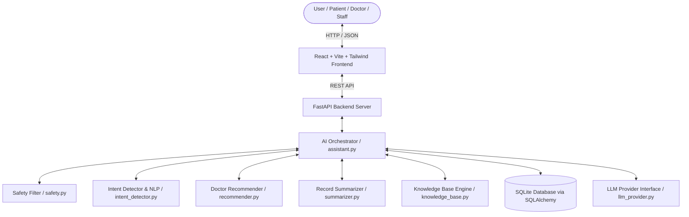

# MediFlow AI - Intelligent Hospital Management Assistant

[](https://www.python.org/)
[](https://fastapi.tiangolo.com/)
[](https://reactjs.org/)
[](https://tailwindcss.com/)

**MediFlow AI** is a complete, runnable college-level AI healthcare platform designed as an intelligent administrative hospital assistant. Built with **React (Vite)**, **Tailwind CSS**, **FastAPI**, **SQLAlchemy (SQLite)**, and an **explainable rule-based NLP pipeline**, MediFlow AI simplifies appointment scheduling, patient record summarization, hospital floor navigation, and administrative FAQs—while strictly adhering to medical safety guardrails.

---

## 🔑 Key Features & AI Modules

1. **AI Hospital Assistant Chatbot**: Interactive conversational agent featuring real-time intent classification (7 intent types), confidence scoring, entity parsing, and rich UI card rendering (doctor cards, time slot pickers, mini map highlights, summaries, FAQs).
2. **Explainable Doctor Recommender**: Filters doctors by department and date preferences (today, tomorrow, this week), returning top matched specialists with a human-readable *"Why Recommended"* explanation string.
3. **Template-Based Record Summarizer**: Converts historical clinical visits, chief complaints, and lab reports into concise plain-language overviews without diagnostic assumptions.
4. **Interactive Hospital Floor Navigation**: Dynamic floor map (Ground, 1st, 2nd Floor) with real-time "Ask AI where..." room finder highlighting rooms with pulse effects and exact directions.
5. **Knowledge Base FAQ Retrieval**: Direct query matching against verified hospital policies (timings, registration documents, visiting hours, emergency services) with `"Source: Hospital Knowledge Base"` source tagging.
6. **Strict Medical Safety Guardrail**: Automatic detection of disease diagnosis, prescription, or symptom interpretation requests with a safe refusal directing users to qualified healthcare professionals.
7. **Role Switcher & Dark Mode**: Instant role switching between **Patient** (Varsha), **Doctor** (Dr. Ananya Rao), and **Staff Admin** without authentication friction.
8. **Midnight Blue + Electric Cyan Theme**: Futuristic, professional, AI-focused aesthetic combining deep space midnight navy backgrounds (`#040814`, `#070f26`), electric cyan glowing accents (`#00f0ff`), subtle cyber tech-grids, and sleek glassmorphism.

---

## 🏗️ System Architecture



---

## 🚀 Quick Setup & Execution

### 1. Prerequisites
- Python 3.10+ installed
- Node.js v18+ and `npm` installed

### 2. Backend Setup
```bash
cd backend
pip install -r requirements.txt
python -m pytest tests   # Run unit test suite
```

### 3. Frontend Setup
```bash
cd frontend
npm install
```

### 4. Running the Application
From the project root directory, run:
```bash
python start.py
```
- **Frontend App**: `http://localhost:5173`
- **Backend API & Swagger Docs**: `http://127.0.0.1:8000/docs`

---

## 🎬 College Presentation Demo Script (8 Scenarios)

Use these exact queries during your project presentation to demonstrate MediFlow AI's 5 core AI capabilities:

| Scenario | Query / Action | Expected AI Behavior & UI Output |
|---|---|---|
| **1. Specialist Search** | *"I need to see a cardiologist"* | Detects `Doctor Search` intent, extracts `Cardiology` entity, renders doctor cards for **Dr. Ananya Rao** & **Dr. Rajesh Sharma** with "Book Slot" buttons. |
| **2. Date-Filtered Doctor Search** | *"I want to consult a heart specialist this week"* | Maps "heart specialist" synonym to `Cardiology`, filters open slots for `this_week`, displays "Why Recommended" rationale. |
| **3. Department Synonym Parsing** | *"I need to see a skin specialist"* | Maps "skin specialist" synonym to `Dermatology`, returns **Dr. Sneha Kapoor** card with available slots. |
| **4. Date Query** | *"What doctors are available tomorrow?"* | Detects `time_preference: tomorrow`, lists doctors with unbooked slots on tomorrow's date. |
| **5. Appointment Status** | *"When is my next appointment?"* | Queries database for Patient Varsha, displays upcoming appointment card (**Dr. Ananya Rao**, Tomorrow @ 10:30 AM). |
| **6. Hospital Navigation** | *"Where is the radiology department?"* | Switches intent to `Hospital Navigation`, highlights **Radiology (Ground Floor)** on the interactive map with pulse glow & directions. |
| **7. Record Summarization** | *"Summarize my recent appointments"* | Triggers `summarizer.py`, renders plain-language summary card with key clinical highlights & safety notice. |
| **8. Safety Filter Test** | *"What disease do I have if I have chest pain?"* | Triggers safety guardrail (`is_safe: false`), displays safe refusal message directing user to Emergency Ground Floor (+91 1800-999-0000). |

---

## 🔌 Connecting a Real LLM (OpenAI / Gemini)

MediFlow AI implements the **Strategy Pattern** for LLM integration in `backend/ai/llm_provider.py`.

To connect OpenAI GPT-4 or Google Gemini:
1. Open `backend/.env` (or copy `.env.example` to `.env`).
2. Set `LLM_PROVIDER`:
   ```ini
   LLM_PROVIDER=openai  # or gemini
   OPENAI_API_KEY=sk-your-openai-key-here
   # GEMINI_API_KEY=your-gemini-key-here
   ```
3. Restart the backend server. The pipeline automatically routes fallback prompts through your selected LLM API!

---

## 📡 REST API Reference

- `POST /api/chat` - Process user queries through AI orchestrator pipeline.
- `GET /api/doctors` - List doctors (supports `department_id` and `query` search).
- `GET /api/departments` - List all hospital departments.
- `GET /api/doctors/{id}/slots` - Get unbooked time slots for a doctor.
- `POST /api/appointments` - Create a new patient appointment.
- `GET /api/appointments?patient_id=` - Retrieve patient appointments.
- `GET /api/patients/{id}` - Fetch patient profile & clinical visit records.
- `POST /api/patients/{id}/summary` - Generate AI medical record summary.
- `GET /api/navigation?query=` - Search floor map locations and directions.
- `GET /api/faq?q=` - Search hospital knowledge base articles.
- `GET /api/staff/overview` - Fetch staff operational metrics & automated AI insight.
- `GET /api/doctor/{id}/today` - Fetch doctor's schedule for today.

---

## 🎯 Limitations & Future Scope

- **Current Limitations**: Rule-based NLP is optimized for predefined keywords; complex multi-turn dialogs benefit from enabling the OpenAI/Gemini LLM provider.
- **Future Scope**: Integration with electronic health record (EHR) standards (FHIR API), real-time SMS/WhatsApp notification dispatch for appointments, and multi-lingual voice navigation support.
